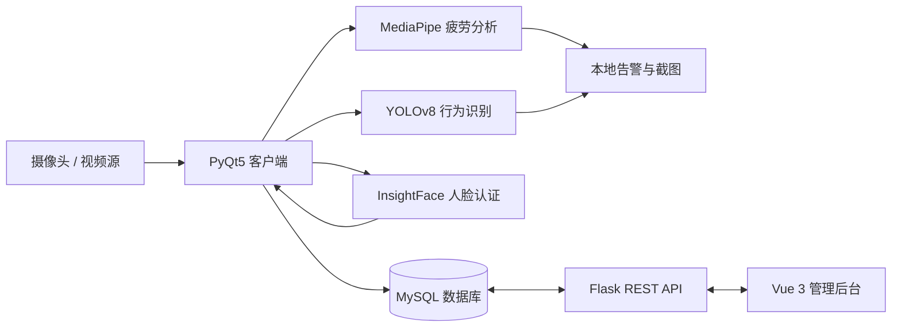

# 智能驾驶员状态监测系统 V1.0

**Intelligent Driver State Monitoring System** — 基于计算机视觉的桌面端监测、Flask API 与 Web 管理后台实践项目。

> 项目作者：Len（李恩念）｜南京邮电大学·信息工程｜2027 届  
> 项目成果：已独立申请并取得软件著作权登记证书（证书文件不在公开仓库中）。

**English overview:** A course project featuring a PyQt5 desktop client, a Flask/MySQL backend, and a Vue 3 dashboard for driver-state monitoring. Source code is provided for technical review; model weights, datasets, personal media, and runtime credentials are not distributed in this repository.

## 系统功能与技术实现

| 层级 | 主要技术 | 功能 |
| --- | --- | --- |
| 桌面客户端 | Python、PyQt5、OpenCV | 摄像头视频处理、监控界面、状态与告警展示 |
| 疲劳识别 | MediaPipe | 依据人脸关键点及阈值判断闭眼、打哈欠、低头 |
| 行为识别 | Ultralytics YOLOv8 | 检测吸烟、使用手机、喝水等行为 |
| 人脸认证 | InsightFace | 人脸特征提取、身份注册与验证 |
| API 服务 | Flask、Flask-SQLAlchemy、PyMySQL | 驾驶员记录、告警记录、统计数据接口 |
| Web 管理后台 | Vue 3、Vite、Element Plus、ECharts | 驾驶员管理、告警列表、图表展示 |
| 模型训练 | Ultralytics YOLOv8 | 训练脚本、配置和训练结果曲线 |

## 系统架构



> 示意图说明原项目的功能模块及数据流；不是已完成的端到端实测证明。

## 项目结构

```text
client/              PyQt5 客户端：main.py、core/、ui/、db/
server/              Flask 服务端：app.py、routes/、services/、models/
frontend/            Vue 3 前端与 package-lock.json
train/               训练与预测脚本、dataset.yaml（无训练数据）
database/init.sql    MySQL 建表脚本
tests/               单元、集成和属性测试源码
docs/SETUP.md        本地搭建说明
docs/training_curves/训练曲线与指标原始 CSV
```

## 本地搭建（研究演示环境）

项目最初按照 Python 3.9 及较早版本依赖开发。此候选版只进行了静态检查及配置检查，**未完成实际安装、摄像头、MySQL、GUI 或端到端运行验证**，因此下列步骤是待验证的复现路径。

1. 建议使用 Python 3.9 虚拟环境，安装 `requirements.txt`。PyTorch/CUDA 组合需要按设备调整。
2. 准备本地 MySQL，执行 `database/init.sql`，创建专用数据库账户。
3. 复制 `.env.example` 为 `.env`，填写 `DB_USER`、`DB_PASSWORD` 等配置；切勿提交 `.env`。
4. 确认授权许可后，将**你有权使用的**训练得到的 YOLO 行为检测权重放在 `client/yolov8_behavior.pt`。仓库**不提供**该权重和训练数据，缺少权重时行为检测不能直接运行。
5. 在项目根目录执行 `python -m server.app`；另一个终端执行 `python client/main.py`。
6. 进入 `frontend/` 执行 `npm ci` 和 `npm run dev`，浏览器访问 `http://127.0.0.1:3000`。

更多说明与局限见 [本地配置指南](docs/SETUP.md)。

## 训练结果与复现边界

`docs/training_curves/` 保留历史训练曲线、混淆矩阵及 `results.csv`，供了解训练过程。原始训练数据集和对应权重**未公开**；暂不能凭此仓库完整复现训练或独立核验历史指标。历史开发文档中的 FPS、CPU 占用等性能数值未经本候选版重新测试，**不作为当前性能保证**；过时的过程性文档没有收入候选仓库。

## 安全与隐私

- API **未实现身份鉴权**，只用于本地开发演示。默认监听 `127.0.0.1:5000`；**切勿直接部署到公网或处理真实个人数据**。
- 人脸特征、告警截图、真实人像、数据库凭据以及申请材料均不包含在本公开候选仓库中。
- `.env`、模型权重、训练数据、缓存与运行产物均由 `.gitignore` 排除；正式发布前仍需人工检查待提交文件。

## 第三方组件与许可

- YOLOv8 使用 Ultralytics 技术栈。**基础模型及派生权重的分发义务须依据适用许可单独核实**；本候选版不提供其权重。
- InsightFace 的预训练模型存在额外用途或许可限制，必须遵守对应模型许可；仓库不包含 `buffalo_l` 权重。
- 本仓库暂不提供统一的开源许可证；**公开可阅读不等于获得任意复制、修改或商业使用授权**。第三方依赖各自适用其许可证。

## 测试状态

本次发布准备阶段完成 Python 语法编译和配置解析类检查；尚未运行完整 `pytest`、GPU 推理、摄像头、MySQL 或 GUI。对外展示时以可核实的代码、配置和原始训练记录为准。

---

**用途：** 2027 届校园招聘技术作品展示 / 学习研究。建议 HR 查看架构、模块说明，技术面试官可进一步阅读 `client/core/`、`server/routes/` 和 `train/`。
