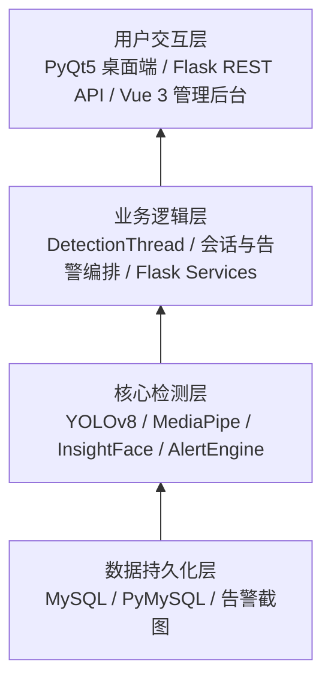

# 智能驾驶员状态监测系统

**Intelligent Driver State Monitoring System** — 基于 PyQt5、YOLOv8、MediaPipe、InsightFace、Flask 与 Vue 3 的驾驶员状态监测实践项目。

> 项目作者：Len（李恩念）｜南京邮电大学·信息工程｜2027 届  
> 项目成果：已取得软件著作权登记证书。证书及完整登记材料不在本仓库中。

**English overview:** A driver-state monitoring project with a PyQt5 desktop client, YOLOv8 behavior detection, MediaPipe fatigue analysis, InsightFace authentication, a Flask/MySQL API, and a Vue 3 dashboard. Model weights, datasets, personal media, runtime credentials, and the complete software-copyright application are not distributed here.

## 版本说明

本仓库同时保留了软著登记版本的核心桌面端能力，并在其后继续扩展。两者边界如下：

| 版本 | 范围 |
| --- | --- |
| 软著登记版本 V1.0.0 | 以 PyQt5 桌面端为主体，包含视频采集、YOLOv8 危险行为检测、MediaPipe 疲劳检测、InsightFace 身份认证、状态面板、告警与 MySQL 持久化。下方截图来自该版本的历史运行记录。 |
| 当前仓库扩展版 | 在桌面端基础上增加 Flask REST API、Vue 3 管理后台、配置安全处理、训练资料整理及自动化测试。扩展内容不应被理解为软著登记范围或登记时已具备的功能。 |

## 历史运行截图

截图来自软著登记版本的历史说明材料。公开前已检查个人信息：YOLOv8 与 MediaPipe 截图中的真人面部、姓名和工号均已匿名化；原始说明书及未处理截图未收入仓库。截图中的 FPS、告警次数和置信度只反映当时单次运行界面，不代表当前版本的性能指标。

### 软件主界面


桌面端采用视频区与控制面板分栏布局，集中提供视频源、身份认证、监测控制、实时状态、统计计数和系统日志。

### YOLOv8 危险行为检测


YOLOv8 检测模块识别 `phone`、`smoke`、`drink` 等行为，并将类别、置信度与检测框绘制到视频帧。仓库不分发自定义模型权重或训练数据。

### MediaPipe 疲劳检测


MediaPipe Face Mesh 提取面部关键点，计算 EAR（眼睛纵横比）、MAR（嘴巴纵横比）及头部姿态，用于闭眼、打哈欠和低头状态判断。截图保留了关键点与诊断信息，人物身份已不可识别。

### 系统状态面板


状态面板同步展示眼睛、嘴巴、头部与危险行为状态，以及 FPS、告警次数和累计持续时间，异常项通过颜色变化突出显示。

## 四层架构

系统按职责划分为数据持久化层、核心检测层、业务逻辑层和用户交互层。当前扩展版在原桌面端之外增加了 Flask API 与 Vue 管理后台。



- **数据持久化层**：保存驾驶员、监测会话和告警记录；截图目录与运行数据默认不公开。
- **核心检测层**：封装危险行为、疲劳状态、人脸特征与预警处理。
- **业务逻辑层**：协调视频源、检测器、会话、告警和服务端数据访问。
- **用户交互层**：提供桌面实时监测界面及扩展后的 Web 管理界面。

## 技术亮点

### QThread 检测线程

`DetectionThread` 继承 `QThread`，在后台完成视频帧读取、YOLOv8 与 MediaPipe 推理、告警处理和帧率控制。主线程负责界面渲染与交互，两者通过 `frame_ready`、`detection_result`、`status_changed`、`error_occurred`、`fps_updated` 等 Qt 信号通信；运行、暂停和组件切换状态由 `QMutex` 保护，避免推理阻塞界面事件循环。

### 连续帧预警

单帧检测容易受遮挡、姿态和瞬时误检影响。行为检测器按类别维护连续帧计数，达到配置阈值后才产生事件，未连续命中则重置；疲劳检测也分别维护闭眼、打哈欠和低头计数。当前配置中的行为阈值默认为 10 帧，疲劳阈值可在 `client/config.yaml` 中调整。

### 30 秒告警冷却

`AlertEngine` 为每种告警类型独立记录最近触发时间，默认在 30 秒冷却期内抑制同类重复告警。有效告警可关联危险等级、截图和数据库记录，从而降低持续状态造成的告警刷屏，同时不影响其他类型告警。

### 状态与告警闭环

检测结果不仅绘制在视频帧上，还会更新状态标签、累计次数与持续时间；告警引擎负责冷却判断、截图和持久化，管理端可通过 API 查询驾驶员、告警与统计数据。

## 功能与技术栈

| 模块 | 主要技术 | 功能 |
| --- | --- | --- |
| 桌面客户端 | Python、PyQt5、OpenCV | 摄像头/视频文件处理、状态与告警展示 |
| 危险行为检测 | Ultralytics YOLOv8 | 手机、吸烟、喝水等行为检测与连续帧过滤 |
| 疲劳检测 | MediaPipe Face Mesh | EAR、MAR、头部姿态与连续帧判断 |
| 人脸认证 | InsightFace | 人脸特征提取、身份注册与验证 |
| 告警与持久化 | AlertEngine、PyMySQL、MySQL | 冷却、截图、会话及告警记录 |
| API 服务 | Flask、Flask-SQLAlchemy | 驾驶员、告警和统计接口 |
| Web 管理后台 | Vue 3、Vite、Element Plus、ECharts | 驾驶员管理、告警列表和图表展示 |

## 项目结构

```text
client/               PyQt5 客户端：core/、ui/、db/
server/               Flask 服务端：routes/、services/
frontend/             Vue 3 管理后台
train/                训练与预测脚本（不含训练数据）
database/init.sql     MySQL 建表脚本
tests/                单元、集成和属性测试
docs/screenshots/     已脱敏的历史运行截图
docs/training_curves/ 历史训练曲线与原始 results.csv
```

## 本地搭建

项目最初按 Python 3.9–3.11 环境开发。PyTorch、CUDA、MediaPipe 与 InsightFace 的兼容组合可能随平台而异，建议使用独立虚拟环境。

1. 安装 `requirements.txt`；开发与测试依赖见 `requirements-dev.txt`。
2. 准备本地 MySQL，执行 `database/init.sql`。
3. 复制 `.env.example` 为 `.env`，填写数据库配置；切勿提交 `.env`。
4. 确认许可后，将有权使用的 YOLOv8 行为检测权重放到配置指定位置。
5. 启动桌面端：`python client/main.py`。
6. 如需扩展管理端，启动 `python -m server.app`，再在 `frontend/` 执行 `npm ci` 与 `npm run dev`。

更多说明见 [本地配置指南](docs/SETUP.md)。

## 训练结果与复现边界

`docs/training_curves/` 保存历史训练曲线、混淆矩阵和 `results.csv`，仅用于展示训练过程。原始数据集与对应权重未公开，因此不能仅凭本仓库完整复现训练或独立核验历史模型指标。README 不将历史界面中的 FPS、置信度或告警计数解释为当前性能结论。

## 测试状态

发布准备阶段在项目指定 Conda 环境中完成全量 pytest：**494 passed，0 failed，0 skipped**。该结果覆盖自动化测试，但不等同于 GPU 推理、摄像头、MySQL、模型精度或真实道路场景的端到端验证。

## 安全与隐私

- Flask API 未实现生产级身份鉴权，默认只用于本地演示，切勿直接暴露到公网。
- `.env`、模型权重、训练数据、数据库、日志、缓存、告警截图与真实人像均由 `.gitignore` 排除。
- 本仓库只保留经过匿名化处理的历史截图；完整软著说明书、登记证书及原始截图不公开。
- 不要使用真实个人数据进行公开演示；如需采集人脸或驾驶员资料，应先取得授权并制定保存、访问和删除策略。

## 第三方组件与许可

- YOLOv8 使用 Ultralytics 技术栈，基础模型与派生权重的分发义务需依据适用许可单独核实。
- InsightFace 预训练模型可能有额外用途或许可限制；仓库不包含 `buffalo_l` 权重。
- 本仓库暂未提供统一开源许可证。公开可阅读不等于获得任意复制、修改或商业使用授权；第三方依赖分别适用其许可证。

---

**用途：** 校园招聘技术作品展示与学习研究。建议先阅读架构与技术亮点，再查看 `client/core/`、`server/routes/` 和 `train/`。
